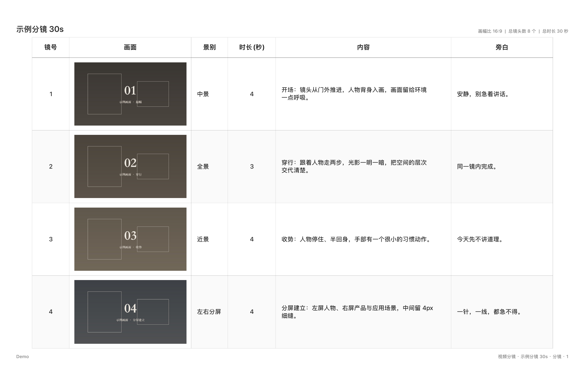

# macScript · 分镜脚本工具 + AI 技能

一个 macOS 上的分镜（故事板）工具，外加一套给 AI 用的技能包：让 AI 直接从参考视频里截画面、生成分镜工程，最后导出成 PDF。



## 这个仓库里有什么

```
app/       macScript 的 Xcode 工程（原生 SwiftUI，无第三方依赖）
skill/     Codex 技能：截画面 → 生成 .macscript → 导出 PDF
examples/  示例分镜（8 镜，含占位画面与规格文件）
docs/      预览图
```

## 1. 装 app

需要 macOS 15.7 或更新版本，以及 Xcode（免费）。

```bash
git clone <这个仓库地址>
open app/macScript.xcodeproj
```

在 Xcode 里按 `⌘R` 直接运行，或菜单 `Product → Archive` → `Distribute App` → `Copy App`，把导出的 `macScript.app` 拖进「应用程序」。

> 如果系统提示「无法打开」，在「应用程序」里右键点它 → 打开，确认一次即可。

### 基本用法

1. 「项目 → 新建脚本」，填脚本名称和制作团队
2. 每一行就是一颗镜头：**镜号 / 画面 / 景别 / 时长 / 内容 / 备注**
3. 画面格子里 `Cmd+V` 直接粘图；左侧三个按钮分别是**拖动排序**、**在下方插入**、**删除**
4. 「列设置」可以加自定义列、改列标题、调列宽
5. 「导出 PDF」拿到成品分镜表

工程文件（`.macscript`）就是 JSON，**画面以 base64 内嵌在文件里**，发给别人不用担心图片丢失。双击 `.macscript` 会直接用 macScript 打开，拖到 Dock 图标上也一样。

## 2. 装技能（可选，给用 Codex 的人）

技能让 Codex 能直接替你做完整个流程：看参考视频 → 按时间点截画面 → 写好镜头表 → 生成工程文件 → 导出 PDF。

```bash
mkdir -p ~/.codex/skills
cp -R skill/macscript ~/.codex/skills/
~/.codex/skills/macscript/scripts/sync_vendor.sh   # 首次编译导出器，需要 Xcode 命令行工具
```

然后直接对 Codex 说，比如：

> 用 macscript 技能，把 `参考片/` 里这三个视频截画面，做一份 40 秒、16 个镜头的分镜，导出 PDF，工程文件也留一份给我改

技能会做四件事：取样截帧给你挑、按规格生成 `.macscript`（能在 app 里直接打开继续改）、生成一份隐藏「排序」列的打印版、导出 PDF 并逐页检查版面。

## 3. 手动跑一遍示例

```bash
cd skill/macscript
./scripts/build_macscript.py ../../examples/demo/spec.json -o ../../examples/demo/demo.macscript
./scripts/build_macscript.py ../../examples/demo/spec.json --hide order -o ../../examples/demo/demo_打印版.macscript
./bin/macscript-pdf ../../examples/demo/demo_打印版.macscript ../../examples/demo/demo.pdf
```

`spec.json` 就是你写镜头表的地方：标题、团队、画幅比、列宽、每一镜的景别/时长/内容/旁白/画面文件，都在这一个文件里。字段说明见 [skill/macscript/references/format.md](skill/macscript/references/format.md)。

## 几个已知的坑（省得你踩）

- **「排序」列别隐藏**：每一行左侧的拖动 / 新增 / 删除按钮就画在这一列里，隐藏了整列，工程就没法增删调序了。要更干净的 PDF，就用 `--hide order` 生成一个只用来导出的副本。
- **尽量别加自定义列**：只要工程里有自定义列，app 打开时会把 景别 / 时长 / 内容 / 备注 压到最小宽度给它腾位置，看着会挤。想加「旁白」这一类，直接改内置列的标题就行。
- **PDF 页面是 1440×900，不做缩放**：可见列宽加起来不要超过 1360，否则表格右边缘会被裁掉。
- 已经装了更早版本的话，重新编译并覆盖安装一次，「双击打开」才会生效——文件类型的声明写在 app 的 Info.plist 里。

## 许可

分享给朋友用，暂未指定开源协议。要用在商业项目或想二次分发，先跟我说一声。
